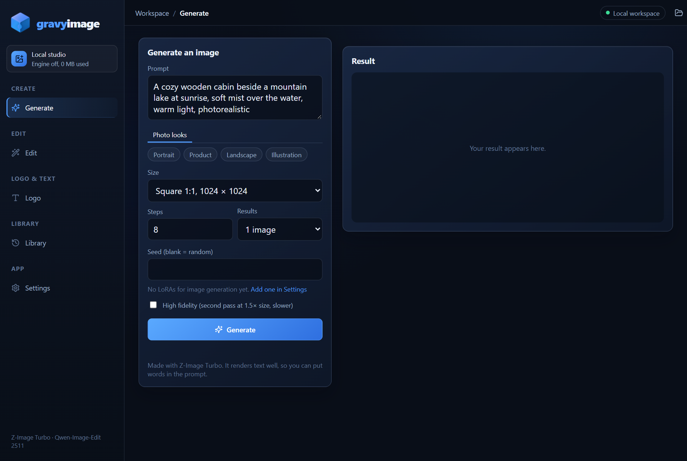
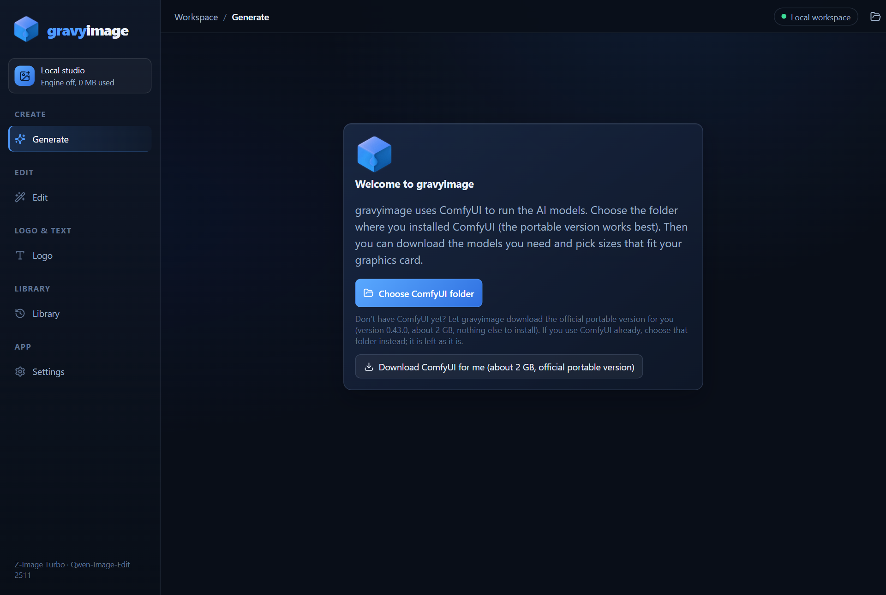
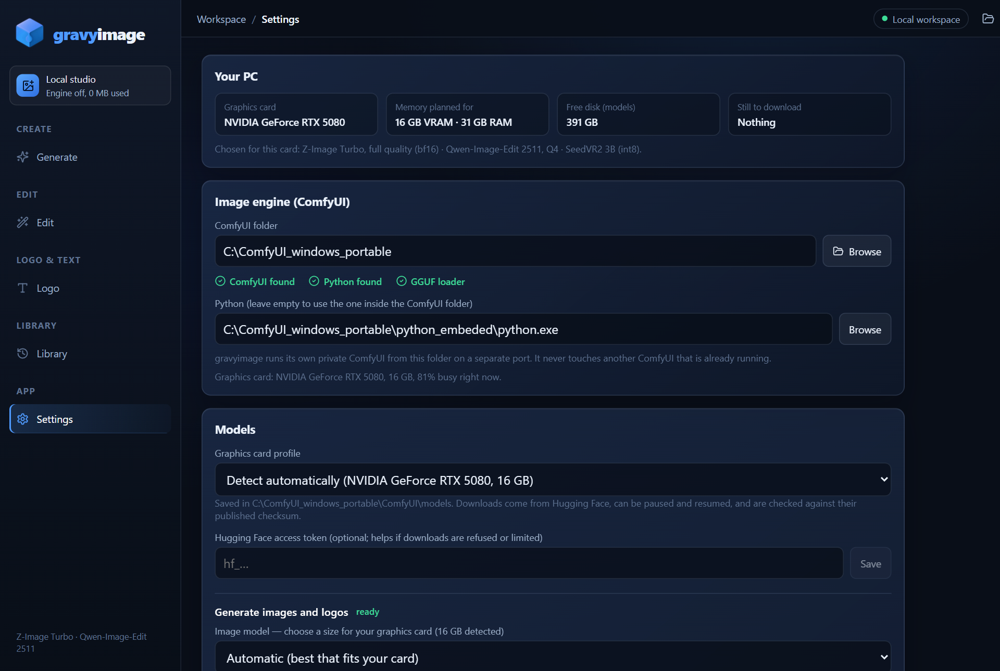
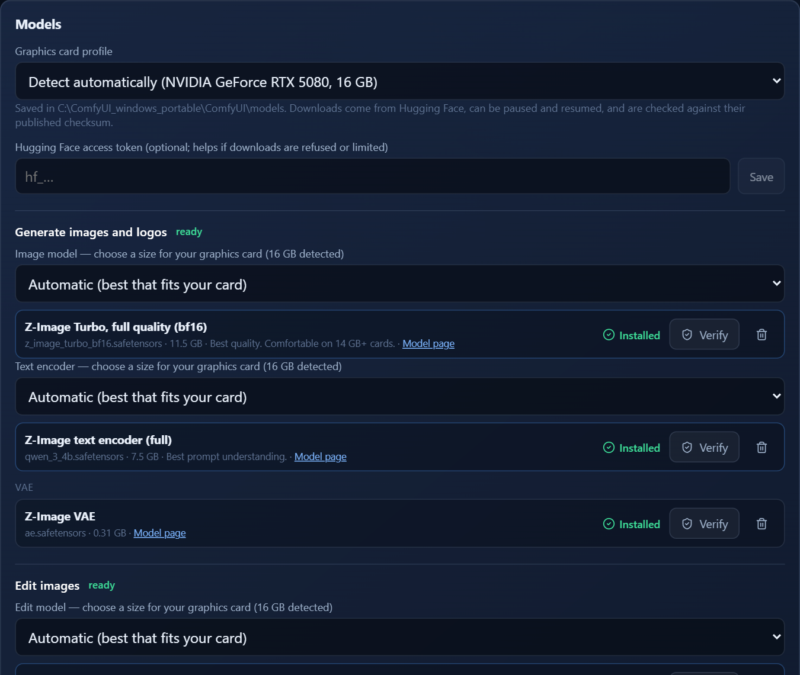
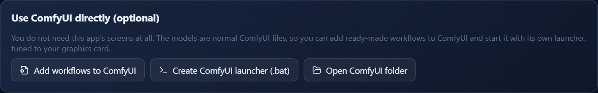
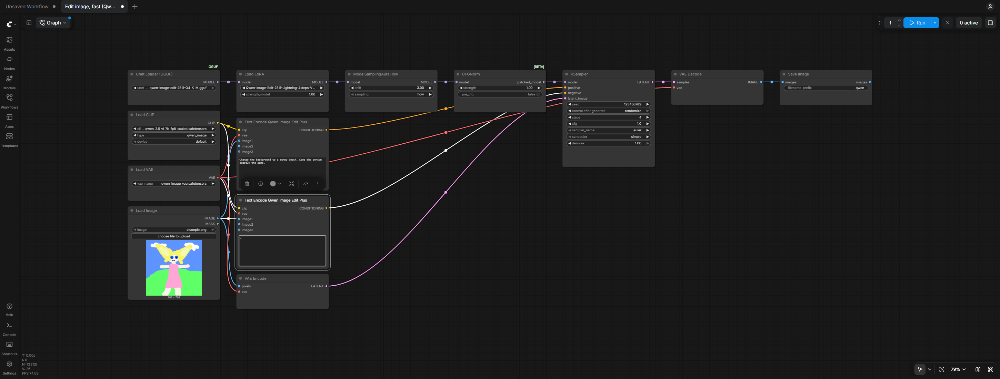
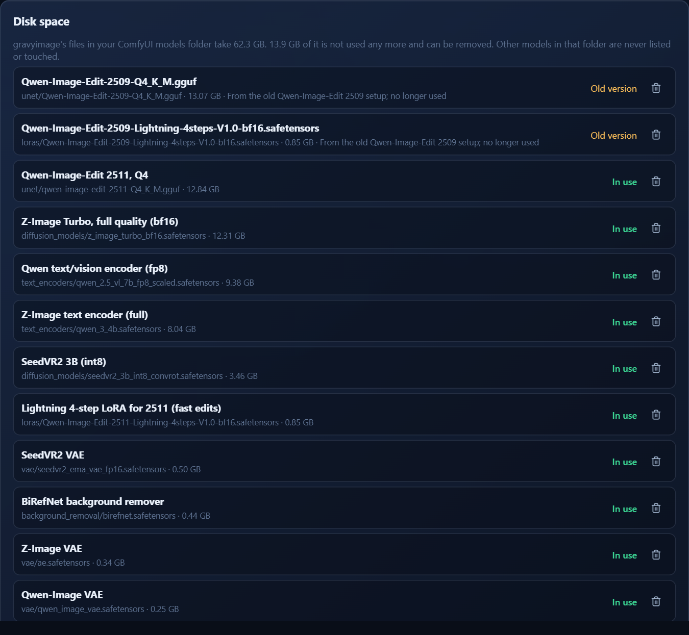

# gravyimage

**An easy way to set up ComfyUI for AI image generation and editing on a Windows PC, with model sizes matched to your graphics card.** The gravyimage app does the setup and gives you a simple studio on top. The app is optional: it can also leave you with ready-made workflows and a launcher, so you can just use ComfyUI itself.

## What you get

- **Generate** photos and logos with [Z-Image Turbo](https://huggingface.co/Tongyi-MAI/Z-Image-Turbo), with many sizes (square by default), several results per run and an optional high-fidelity second pass
- **Edit** a picture with a plain instruction using [Qwen-Image-Edit 2511](https://huggingface.co/Qwen/Qwen-Image-Edit-2511): outfits, backgrounds, lighting, with the person kept the same. Before/after slider included
- **Restore resolution** after an edit, **cut out** backgrounds, and put **text or a logo** over an image
- Your own **LoRAs** are found automatically in ComfyUI's `loras` folder
- **Setup that fits your PC:** one button gets ComfyUI, models come in sizes for 6, 8, 12, 16, 24 and 32 GB graphics cards, and every download is checked for damage
- **Progress bar and Cancel**, a seed and the prompt saved with every result, **Retry** and **Same seed**
- **Polite GPU sharing:** if another app is busy on the graphics card, gravyimage waits (or warns), and it frees memory soon after each job

It runs entirely on your own PC. Nothing is sent anywhere except the downloads from GitHub and Hugging Face.

## Install

1. Download the latest `gravyimage-portable.zip` from [Releases](../../releases) and unzip it anywhere.
2. Run `gravyimage.exe`.
3. **If Windows says "Windows protected your PC":** click **More info**, then **Run anyway**. gravyimage is not code-signed yet, so Windows shows this for every new unsigned app. Only do this for a copy you downloaded from this repository's Releases page.
4. On first start, click **Download ComfyUI for me** (about 2 GB), or choose a ComfyUI folder you already have.
5. In **Settings > Models**, click **Download everything recommended**, or pick sizes yourself. Downloads can be paused and resumed. If asked, click the button to install the GGUF loader.

Images are saved to `Pictures\gravyimages` unless you change it in Settings. The app keeps its settings in a `data` folder next to the exe and runs its own private ComfyUI on port 8190, which stops when you close the app. It never touches another ComfyUI you have running.

## Sizes for your graphics card

Models are chosen automatically from your card's memory (you can override this in Settings). The totals below include everything for generating, editing, cut-outs and Restore resolution; the app shows exact sizes before you download anything.

| Graphics card | Z-Image Turbo | Edit model | Restore | Total download |
|---|---|---|---|---|
| 6 GB or less | Q4 | Q2 | SeedVR2 3B int8 | about 29 GB |
| 8 GB | Q5 | Q3 | SeedVR2 3B int8 | about 32 GB |
| 12 GB | Q8 | Q3 | SeedVR2 3B fp16 | about 40 GB |
| 16 GB | full quality | Q4 | SeedVR2 3B fp16 | about 47 GB |
| 24 GB | full quality | Q6 | SeedVR2 7B fp8 | about 54 GB |
| 32 GB or more | full quality | Q8 | SeedVR2 7B fp8 | about 58 GB |

Cards with 8 GB or less run in a low-memory mode: smaller models, and part of each model streams from system RAM, so edits take longer. That needs 16 GB of RAM or more (32 GB is better). The optional fast-edit LoRA adds 0.8 GB.

## Use ComfyUI directly (optional)

You don't need gravyimage's screens at all. Under **Settings > Use ComfyUI directly**:

- **Add workflows to ComfyUI** puts ready-made workflows for generating, editing (fast and high fidelity), removing backgrounds and restoring resolution into ComfyUI's own workflow list, under a `gravyimage` folder. They already point at the models you downloaded.
- **Create ComfyUI launcher (.bat)** makes `run_comfyui_gravyimage.bat` in your ComfyUI folder, with the right options for your graphics card. Double-click it, open <http://127.0.0.1:8188>, press `W` and pick a workflow.

## Keeping your disk tidy

**Settings > Disk space** lists everything gravyimage keeps in ComfyUI's models folder, with sizes, and flags files that are no longer used, such as an older edit model. Other models in that folder are never listed or touched.

## ComfyUI

gravyimage uses ComfyUI to run the models. It was built and tested with **ComfyUI 0.43.0** (released 27 Oct 2026, Python 3.13, PyTorch 2.14 with CUDA 13). Newer versions should work; older ones may be missing nodes the app needs.

- NVIDIA, pinned to 0.43.0 (1.9 GB): <https://github.com/comfyanonymous/ComfyUI/releases/download/v0.43.0/ComfyUI_windows_portable_nvidia.7z>
- NVIDIA, always the newest: <https://github.com/comfyanonymous/ComfyUI/releases/latest/download/ComfyUI_windows_portable_nvidia.7z>
- Release page, with the other variants: <https://github.com/comfyanonymous/ComfyUI/releases/tag/v0.43.0>

The **Download ComfyUI for me** button fetches the pinned version for you and unpacks it with Windows' own tools. Or extract the archive yourself with [7-Zip](https://www.7-zip.org/) and choose the folder that contains `ComfyUI` and `python_embeded`. If you already have a ComfyUI install, point the app at that instead; it is not modified apart from the GGUF loader add-on, which the app installs from Settings on request.

## Requirements

- Windows 10 or 11 with the WebView2 runtime (included with Windows 11)
- An NVIDIA graphics card
- ComfyUI 0.43.0 or newer, the Windows portable version (the app can download it for you)
- Disk space for the models you download (see the table above) plus about 9 GB while ComfyUI unpacks

## Something wrong?

**Settings > About > Copy diagnostics** copies a plain-text report (versions, graphics card, which models are installed, recent errors) that you can paste into an issue. It contains no images or prompts, and your Windows user name is replaced with `~`. **Check for updates** only asks GitHub for the newest release number; nothing is installed for you.

## Versions

- **v0.1.0:** first public build.
- **v0.2.0:** Download ComfyUI for me, workflows and launcher for plain ComfyUI, a "Your PC" check, checksum verification and a repair button for downloads, a Hugging Face token option, disk-space manager, automatic LoRA detection, many more image sizes with square as the default, update check and diagnostics.
- **v0.2.1:** the app's local backend is locked down so only the gravyimage window can use it.
- **v0.2.2:** tidier layout, Generate shows only its own last image with a Clear button, Library Open folder button, fast-edit LoRA listed under LoRAs.
- **v0.3.0:** job queue, a rebuilt text and logo editor (any installed font, many styles, positioning, opacity, tiled watermarks) and 21 AI logo styles.

Models are downloaded from Hugging Face under their own licences. This repository only holds the downloadable builds; the source code is private.
